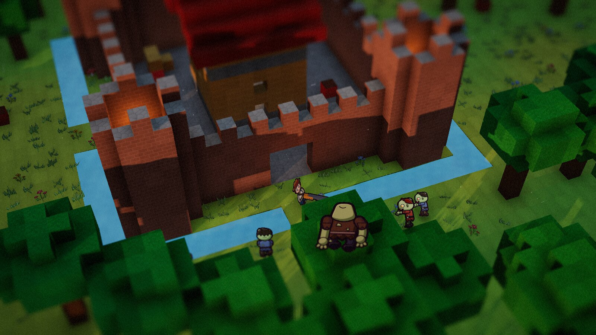
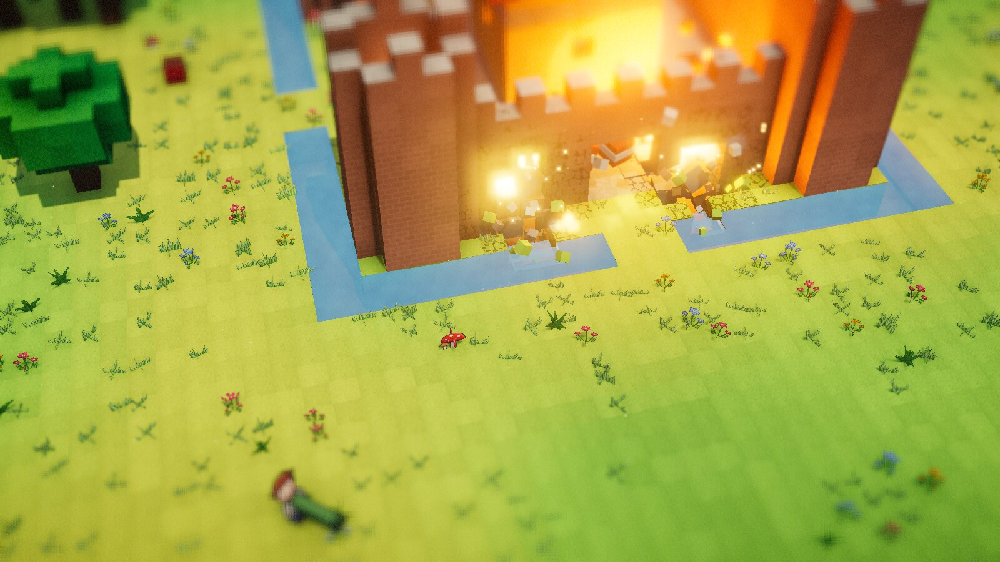
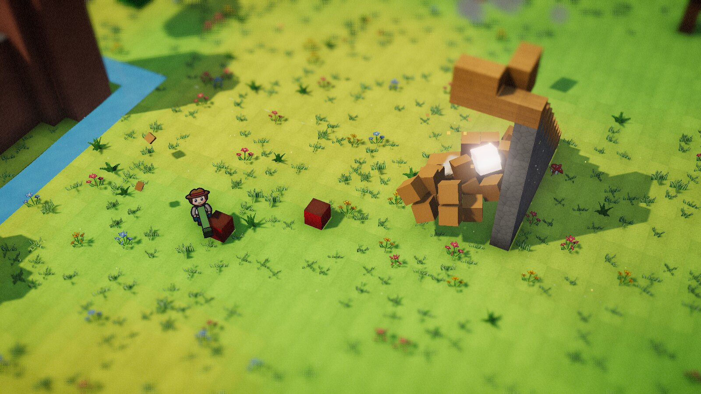
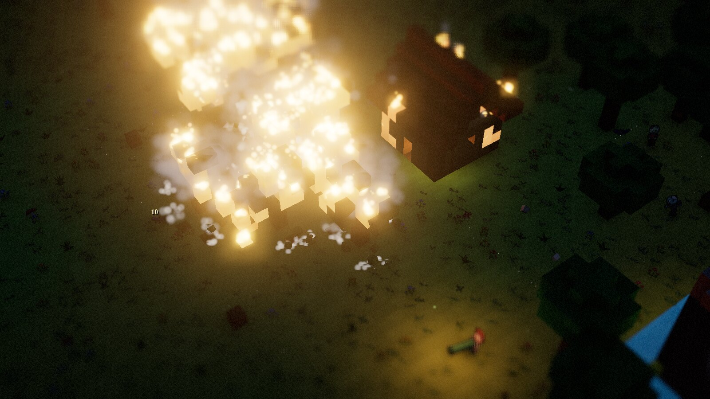
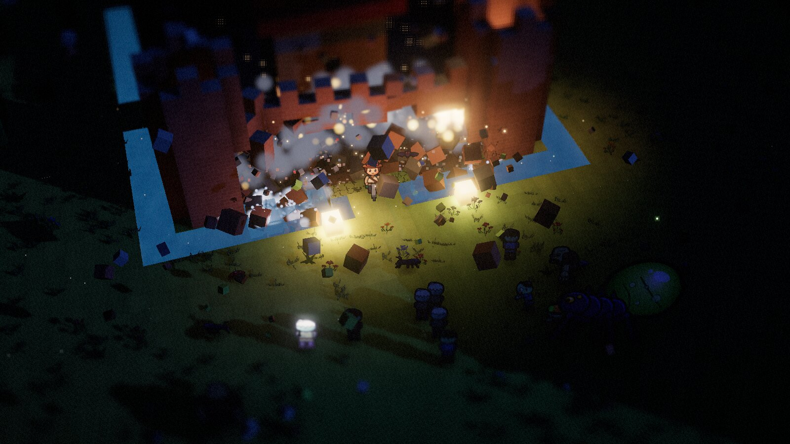
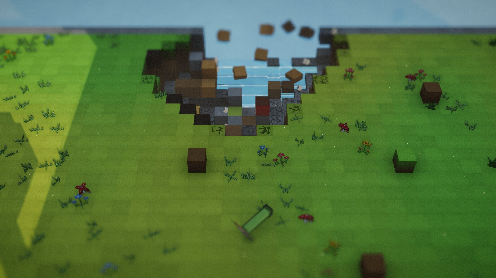
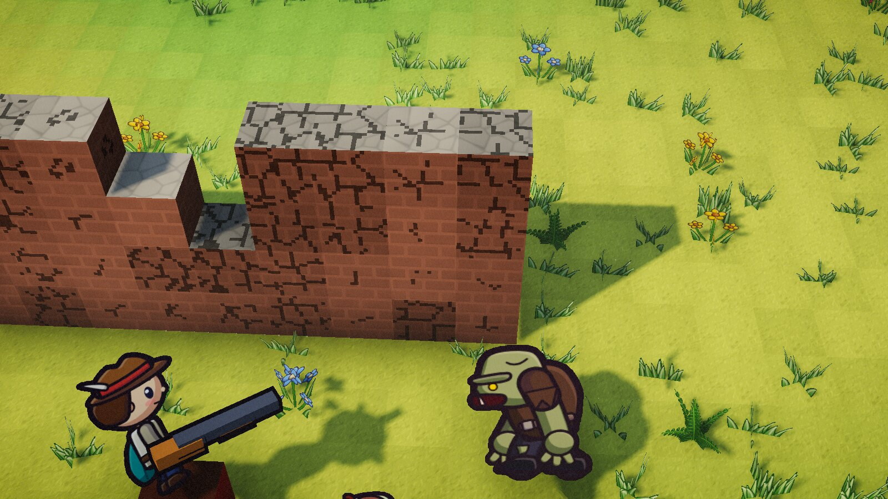
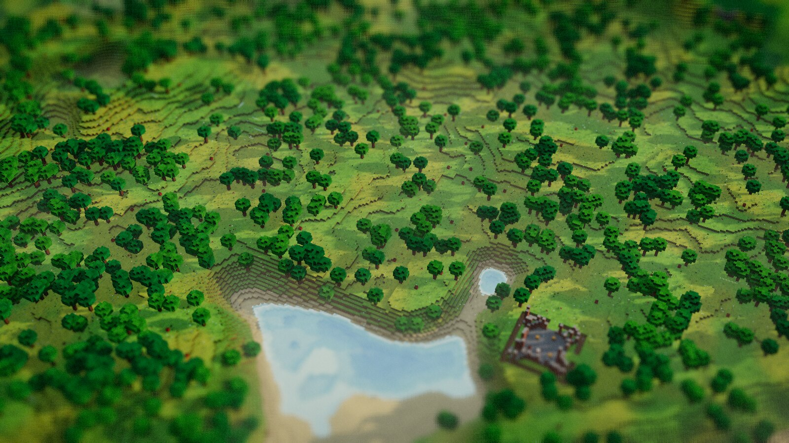

# Blockfall Isle: first-person voxel survival

A browser survival game in a destructible 3D voxel world. Gather materials, build defenses, craft supplies and hold off the night. Ground characters and held weapons are procedural 3D models; the flying enemy uses a CC0 Kenney model; textures and icons are generated at runtime; music and a block-breaking effect are locally hosted audio assets.

## Gallery

[First-person screenshots and browser verification](docs/FIRST_PERSON_VERIFICATION.md) show the current game and reproducible gameplay checks.

*The screenshots below show the earlier overhead version of the game.*


*Golden hour at the castle. Low sun through N8AO, bloom and tilt-shift; inked vector characters walk the voxel world.*

| | |
|---|---|
|  |  |
| **TNT chain reaction.** Two charges blow the castle wall open, and bricks fly as Rapier rigid bodies. | **Structural collapse.** Blow out a tower's legs and it topples as one rigid voxel body, then shatters. |
|  |  |
| **Wildfire at dusk.** Fire spreads through leaves and logs and lights the hut, and burnt-out trunks fall. | **Night 3.** The horde pours through the breach by lantern light while the Brood Mother arrives. |
|  |  |
| **Flooding and buoyancy.** A crater blasted into the coast fills from the sea; planks, logs and crates float, and stone sinks. | **Damage you can read.** Every block shows procedural cracks as it takes damage, alongside the 3D characters. |


*Zoomed out over the 5120 × 512 × 5120 world. Every tree, terrace and the ruined fort is a live, destructible voxel; low-detail terrain carries the view to the horizon.*

## Run it

A Vite + TypeScript web app (three.js r169, Rapier 0.21).

```sh
npm install
npm run dev        # dev server with hot reload, then open the printed URL
npm run build      # typecheck (tsc) + production build into dist/
npm run preview    # serve the production build
```

The chunk mesher is Rust compiled to WebAssembly (`crates/voxel-core`). The built module is committed
in `src/wasm/`, so the commands above work without a Rust toolchain. To rebuild it after changing the Rust code:

```sh
rustup target add wasm32-unknown-unknown
# the shared-memory (threads) build rebuilds std with atomics, which needs a nightly
rustup toolchain install nightly-2026-10-01 --profile minimal --component rust-src --target wasm32-unknown-unknown
cargo install wasm-bindgen-cli --version 0.2.104
npm run build:wasm
```

Tests (no browser needed for most; see `.claude/skills/fast-3d-testing/SKILL.md`):

```sh
npm run qa                 # Node-only unit tests (geometry, worldgen, waves, defenses), about 1 s
npm run qa:changed         # only the tests covering what you changed
npm run probe -- --eval-file tests/e2e/architect.js   # a journey in the running game (needs npm run dev)
```

`?fast=1` loads a cheap page for testing: small world radius, no post-processing or shadows, muted, straight into a game.

Pushes to `main` are built by GitHub Actions and deployed to GitHub Pages
(enable it once under **Settings → Pages → Source: GitHub Actions**).

## Controls

Click the game to capture the mouse. Move the mouse to look and aim at the center crosshair.

| Input | Action |
| --- | --- |
| WASD | move relative to view |
| Space / Shift | jump / dash |
| Z or double-tap Space | toggle the fuel-free jetpack; while flying, hold Space to ascend and Ctrl to descend |
| WASD while flying | steer the jetpack |
| Left mouse | shoot or place the selected item; hold to cut with the laser cutter |
| Right mouse | mine the targeted block; also works as a laser-cutter mining shortcut |
| 1–0 | choose a hotbar slot |
| F | select the laser cutter (also selected at game start) |
| Q | architect view: overhead camera for planning and building the castle (Q or Esc returns) |
| R | rotate the selected defense |
| T | start the next wave early for up to 50% more clear rewards |
| E / J | gather a targeted fruit or berry / eat food |
| E | use a nearby drawbridge or workbench |
| Tab or C | crafting (time slows while open; advanced recipes need a nearby workbench) |
| H | use a medkit |
| Esc | release the mouse and pause |
| F1 / ? | open Help and controls |
| B | world map |
| F5 / F9 | quick-save / quick-load |
| N | toggle minimap |
| P / O / G / V / M | pixel mode / tilt-shift / ambient occlusion / light shafts / mute |

Press Q to build. The camera eases up into an overhead architect view (see [Architect mode](#architect-mode)) where you draw walls, rooms, towers, stairs, moats and defenses with the mouse instead of walking to each spot. Choose **Defenses → Workbench** there (or **Place Workbench** in crafting) and click supported ground to place a workbench; press E nearby to open crafting and unlock advanced recipes. The drawbridge is also placed from Defenses (R rotates its span) and makes a 2×3 span across a moat; press E nearby to raise or lower it. Help and Settings are available from the title and pause menus. Settings provides separate Music and Effects volume sliders; M mutes both. Sandbox mode makes all construction free; the separate free construction option (in the architect toolbar) covers building blocks. Structural support still matters: sections with too long an unsupported span can fall. Connected water can flow into a dug moat.

The laser cutter is selected when a new game starts, and F selects it at any time. Hold the primary button to cut visible blocks or tree trunks within 8 m; the first solid block stops the beam. Buy power upgrades with iron and range upgrades with copper in the crafting panel while near a workbench. The starter kit includes enough ore for an initial upgrade. Cut blocks give their normal raw-resource drops directly, while right-click remains available for the usual mining action. The context panel shows the target, distance, bedrock/range feedback, and cutting progress.

## What's in it

**First-person rendering**
- Move and aim from the player's viewpoint, with procedural 3D ground characters and held weapons, and a Kenney flying enemy model.
- The flying model is from [Kenney Starter Kit FPS](https://github.com/KenneyNL/Starter-Kit-FPS), whose assets are CC0. See [asset research](docs/ASSET_RESEARCH.md) for sources and alternatives.
- Voxel chunks use procedural detail textures, per-vertex ambient occlusion, painterly colour patches and drifting cloud shadows.
- The day/night cycle brings sunsets, moonlight, lanterns and volumetric light shafts.
- Guns eject casings, enemies react to hits, and destruction produces debris and particles.

**A 5120 × 512 × 5120 world**
- The world is 26 million columns and 13 billion blocks, stored as sparse 32³ chunks. A chunk that is all air (open sky) or all rock stores a single fill value instead of 32 KB, so only chunks near the surface cost memory.
- Terrain is generated in Web Workers, one 32-wide column of chunks at a time:
  - continents and a ragged coastline in an endless sea
  - plains, hills and lakes
  - ridged mountain ranges up to ~490 blocks with snowy peaks and bare rocky slopes
- Structures are placed per 192-block region by hashing the seed: ruined forts, hut villages, watchtowers and dammed reservoirs. Every builder writes through a writer clipped to the column being generated, so any column can be generated on its own and a fort spanning four columns comes out identical whichever is generated first.
- Columns generate nearest-first around the player and chunks mesh nearest-first. Jobs for chunks the player has already left are dropped. Untouched columns far away are dropped from memory and regenerate from the seed if you come back. Columns you've changed stay loaded and go into saves.
- Water simulates within 80 blocks of the player. Pathfinding, the enemy grid and the ocean's shoreline texture all cover a window that follows the player, not the whole world.

**Voxel core in shared memory**
- The Rust crate is built with WebAssembly threads, so its memory is one shared `WebAssembly.Memory`. The main thread, the generation workers and the mesh workers all run the same module on it.
- Every chunk array (blocks, decor, water) is a 32 KB slab from the Rust allocator, used from TypeScript as a `Uint8Array` view. A chunk table in the same memory records each chunk's slabs.
- Generation workers write columns straight into slabs. Mesh workers gather a chunk's 26 neighbours from the table themselves. No voxel data is ever copied or transferred between threads; only finished geometry comes back.
- Shared memory needs a cross-origin isolated page. The dev and preview servers send COOP/COEP headers. On static hosts without them (GitHub Pages), a tiny service worker (`public/coi-sw.js`) adds the headers.

**Rust/WASM chunk mesher**
- Chunk meshing is Rust compiled to WebAssembly: face culling, per-vertex AO, damage and fire shading, and crossed-card foliage. Each 32³ chunk is meshed from a padded 34³ volume gathered from its 26 neighbours, so borders and AO are seamless in all three axes.
- Greedy meshing merges coplanar faces of the same block, face, state and per-vertex AO into larger quads. A quad only grows along an axis where its AO doesn't change, so the AO shading (and the AO-aware diagonal flip) looks exactly as it did with one quad per face. Damaged or burning blocks never merge. On real terrain this cuts solid vertices by about 35% around the castle, 30% on wooded plains and 16% in mountains.
- Per-block colour variation (hash tint, painterly grass and leaf patches, the ember tint of burning blocks) is computed in the world shader from the block cell, bit-identical to the old vertex-colour version, so it doesn't stop faces from merging. Vertex colours carry only face colour, AO and damage.
- Streamed chunks are meshed in a pool of Web Workers, completely off the main thread. Chunks you edit near the player are remeshed immediately on the main thread with the same WASM module.
- Vertices use compact formats: u8 positions, i8 normals, u16 colours and u8 flags, about 15 bytes per vertex.
- `cargo test` checks that the merged mesh covers exactly the faces of the per-face mesh, with no holes or overlaps and with matching colours.

**Far view**
- Far terrain: four nested clipmap rings (4 to 32 blocks per vertex, out to ~2 km) built from the analytic heightfield in workers, flat-shaded and coloured like the voxel surface, so distant mountain ranges show beyond the meshed voxels. A per-column mask hides them wherever voxel chunks are meshed.
- The minimap (1 block per pixel) and a whole-world map (B, or double-click the minimap) are rendered in workers from the analytic terrain, with landmarks, enemies and the boss marked.

**Water**
- Water is a volume-conserving voxel simulation: it falls, spreads and settles. The ocean is an infinite source, so craters dug below sea level flood.
- The castle has a moat, and a reservoir sits behind a cobblestone dam on the highest hill. Blow the dam and it floods downhill.
- Water puts out fires, and you can wade and swim in it.
- Debris floats or sinks by material: planks, logs, crates and barrels bob on the surface and right themselves, TNT floats low, and stone, brick and metal sink. Mixed wreckage tilts toward its heavy end. Floating pieces drift on a slow current, wash ashore or become waterlogged, and splash when they hit the water.
- Inland holes dug below sea level stay dry until water actually reaches them; the ocean plane only draws over the real sea.

**Saving**
- Games are saved to IndexedDB. Only the 32³ chunks you changed are stored, as gzip-compressed voxel, decor and water arrays; everything else regenerates from the seed.
- The game autosaves at dawn and every two minutes, and the title screen offers Continue.

**Building in 3D**
- Climb walls and bastions, place turrets on elevated platforms, and shoot down from battlements.
- Dig moats, bridge gaps and see structural supports fail when their foundations are destroyed.
- Crawler bugs climb walls, and explosions launch enemies into the air.

**Physics and simulation** (Rapier 0.21 via WASM, with a built-in fallback if it fails to load)
- The terrain near the player and around every falling body is mirrored into Rapier (SIMD build) as one voxel collider per 32³ chunk. Each collider holds only the exposed shell, is built within a per-frame budget, and is kept in sync on every block edit.
- Structures that lose support become dynamic voxel rigid bodies with real mass and inertia. They pivot over whatever still touches them and topple like Angry Birds towers. On a hard impact they shatter into individual rigid bricks, and bricks that come to rest are written back into the world as rubble you can mine.
- Explosions throw intact blocks around as rigid bricks, and fast bricks hurt enemies.
- Every block can be destroyed. Bullets chip blocks, and rockets, grenades and TNT carve craters.
- Structural integrity: each material has a maximum span. Stacking blocks is free, but every horizontal or hanging link costs 1, so anything that loses its load path breaks off as a rigid chunk. Chunks tip, fall, crush whatever is underneath, then shatter into tumbling debris and rubble piles. Knock out a tower's base and it comes down; cut a tree trunk and it topples.
- TNT is primed by bullets, fire or blasts, so it chain-reacts.
- Fire spreads through wood, leaves, grass and enemies. Burnt grass turns to scorched earth, and burnt-out supports cause collapses.
- Fast-moving debris hurts enemies (Angry Birds style).

**Survival**
- After taking damage, recover 1 HP per active second once 8 seconds pass without another hit. Healing pauses while burning and never exceeds maximum HP; medkits still heal immediately.
- Gather apples and berries with E, or hunt deer and boar for meat. Food counts appear on the HUD; use J or the Eat buttons in crafting to queue healing at 2 HP/s.
- The jetpack is available from the start with unlimited fuel. Toggle it with Z or a double-tap of Space; WASD steers, Space ascends and Ctrl descends. Voxel collision remains active while flying.
- Each game starts with 120 seconds of peace to gather and build. When the HUD early-start prompt is visible, press T to start the next wave early; skipping the remaining peace adds a proportional bonus of up to 50% to the reward paid only when that wave is cleared. A finite hostile wave starts automatically when the timer runs out; the next 120-second build window begins only once the last enemy in that wave is defeated. Day and night continue visually, but they do not trigger combat spawns.
- Waves begin with 30, 42, 54, and 66 hostiles, growing to a maximum of 135. They approach from one, two, three, and then four compass fronts. Wave 3 brings the **Brood Mother** boss, who lobs acid volleys, births crawlers, and bulldozes walls. Defeat her to win, then keep going in endless mode.
- After each cleared wave before the boss, pick 1 of 3 upgrades (damage, speed, blast radius, mining, turrets, magnet, supplies).
- Horde pathfinding uses Dijkstra flow fields over a 192-block window around the player. Walls cost the time it takes to break them, so zombies go through gates and gaps and only dig when that's quicker. Climbers have their own field that lets them scale walls.
- Enemies:
  - **Brutes** smash walls three times as hard.
  - **Bats** fly over your defenses.
  - Oil **barrels** explode into fire.
- Zombies batter through any walls you build. Crawlers pounce and climb. Spitters lob acid that eats blocks.
- Wave state and countdown are saved. Saves without the wave-state field resume using their legacy night and living-enemy state.
- Mine iron, copper and coal underground. Crafting shows ore counts and offers portable refining: 2 iron plus 1 coal makes 3 metal, or 2 copper plus 1 coal makes 2 metal. Ore also powers laser upgrades.
- Mine materials and loot crates and enemies (wood, stone, metal, goo), then craft ammo, rockets, grenades, building blocks, TNT, lanterns, medkits and auto-turrets.

## Code tour

| File | What it does |
| --- | --- |
| `src/main.ts` | Game loop, renderer and post-processing, lighting and day cycle, camera, input, combat, crafting |
| `src/world.ts` | Sparse 32³ chunk storage, streaming (generation and meshing queues, unloading), cutaway shader, voxel raycasting, structural integrity, fire |
| `src/core.ts` | The shared-memory voxel core: creates the shared WebAssembly memory and chunk table, hands out slabs, lets workers join |
| `src/blocks.ts` | Block table and deterministic noise (no renderer dependency, so workers can use it) |
| `src/physics.ts` | Instanced small debris; fallback chunk/TNT physics when Rapier isn't available |
| `src/rigid.ts` | Rapier world: voxel terrain collider, toppling voxel bodies, rigid bricks, TNT |
| `crates/voxel-core` | Rust chunk mesher (compiled to `src/wasm/`) |
| `src/meshing.ts`, `src/meshCore.ts`, `src/meshWorker.ts` | WASM mesher glue, worker pool, compact-geometry builders |
| `src/worldgen.ts`, `src/genWorker.ts` | Deterministic column generation in workers: analytic terrain, region-hashed structure sites, clipped builders; the worker also samples far terrain, maps and shoreline |
| `src/minimap.ts` | Minimap and world map rendered in a worker from the analytic terrain, with live markers |
| `src/farTerrain.ts`, `src/terrainSample.ts` | Far-terrain LOD rings from the analytic heightfield (sampled in workers), the terrain-sampling worker pool |
| `src/water.ts` | Voxel water cellular automaton, water meshing and shader, moat and reservoir |
| `src/save.ts` | IndexedDB save/load of modified chunks, gzip-compressed |
| `src/volumetric.ts` | Volumetric light-shaft post pass (shadow-map ray march) |
| `src/flowfield.ts` | Dijkstra flow fields for horde pathing (walkers and wall-climbers) |
| `src/entities.ts` | Player, enemies and their AI, turrets, pickups, ragdoll corpses, voxel collision |
| `src/projectiles.ts` | Bullets, rockets, bouncing grenades, lobbed acid |
| `src/particles.ts` | Point-sprite particle systems (glow, smoke, chunky bits that land) |
| `src/sprites.ts`, `src/art/` | Procedural foliage, UI icons, block detail atlas, and texture baker |
| `src/architect.ts` | Architect mode: overhead planning camera, input, previews, queued bulk building, undo/redo |
| `src/architectPlans.ts` | Pure shape geometry for the architect tools (walls, rooms and roof pillars, towers, stairs, moats); unit-tested in `tests/architectPlans.test.mjs` |
| `src/construction.ts` | Workbenches, drawbridges and their interactions |
| `src/audio.ts` | Music playback and sound effects |
| `src/ui.ts` | HUD, hotbar, crafting panel, floating damage numbers |

### Defenses

Craft defenses at a nearby workbench, then choose a type in the Tab crafting panel (crafting one also equips it). Slot 9 equips the selected defense. Aim at level ground and use the colored footprint preview: green is valid, red needs attention. Every cell needs solid support and clear space. Press R to rotate; click to deploy. The blue circle shows maximum range, and the orange circle shows minimum firing range measured horizontally from the center. The panel reports the footprint, range, ammunition, and any placement problem.

Auto turrets cover nearby targets with rapid fire. Heavy cannons hit harder, twin cannons fire faster, rocket batteries reach distant targets with explosives, and artillery reaches furthest. Each defense holds fire within its minimum range. Explosive defenses also hold shots that would strike inside that range or threaten their own supporting blocks. Heavy weapon blasts can crater terrain and destroy any structures, including your own castle, so leave room around targets. A rocket battery uses four rockets for a full volley. Empty defenses remain in place. Aim at one nearby and press E to reload it from your inventory: auto turrets use SMG rounds, rocket batteries use rockets, and cannons and artillery use shells. Reloading fills only the missing ammunition. Defense type, orientation, health, and remaining ammunition are saved.

### Architect mode

Q switches to a RimWorld-style planning view. The camera rises above your character (a cyan beacon marks where you stand), the mouse is free, and time keeps running unless you press Space to pause it. Nothing requires walking: plan anywhere within about 230 blocks of your character.

| Tool | Drag to… |
| --- | --- |
| 1 Wall | enclose a rectangle with walls of the set height and thickness, or draw a straight wall with a thin drag |
| 2 Line wall | draw a wall at any angle (diagonals, star forts) |
| 3 Block | fill a solid volume: floors, platforms, ramparts, a 100 × 200 × 5 curtain wall |
| 4 Room | build a floor, four walls, a doorway on the side facing the camera and an optional roof; wide roofs get pillars automatically so they don't sag |
| 5 Tower | drag out a radius for a round tower (hollow with a top floor, or solid) |
| 6 Stairs | climb one block per step toward where you release, up to the set rise |
| G Level | flatten the dragged area to the height you start on: dips filled with earth (which never collapses), hills and trees cut away |
| 7 Dig | excavate to the set depth, cutting through hills (optionally flooded) |
| 8 Moat | dig a ring trench of the set width and depth and fill it with water |
| 9 Erase | remove built blocks from the clicked height upward (terrain is left alone unless *Built only* is off) |
| 0 Defenses | click to deploy turrets, traps, workbenches and drawbridges; R rotates, rings show range |

Materials are brick, cobble, planks, metal and roof tile. Battlements add one row of crenellations on the outer edge. Foundations (F cycles) are Off, Fill down (each column extended down to the ground) or Level (the whole footprint flattened to the start height, as with the Level tool). Bricks reach only 3 blocks sideways from a support, so a wall over a gap wider than 6 loses its middle: the preview marks blocks that would fall in red. The green preview shows every block with its voxel grid, and the tooltip shows the size and block count (red means it can't be built: not loaded, out of the world, or not enough blocks). Each operation can place up to 1,000,000 blocks; large ones are written bottom-up over several frames with a progress bar in the toolbar. Existing blocks are kept, cells occupied by creatures are skipped, and Ctrl+Z / Ctrl+Y undo and redo whole operations.

Camera: WASD or arrows pan (Shift faster), the wheel zooms toward the cursor, right-drag orbits, middle-drag pans, Z / X turn 45°. Height: [ and ] or Ctrl+wheel; thickness: − and = or Alt+wheel. For multi-storey buildings, PgUp / PgDn (or Shift+wheel) lock a working level and Home returns to following the ground; with Slice on, built blocks above the level are hidden so you can see into the floor you're working on. Without a locked level, dragging starting on top of an existing structure builds on top of it.

Defense models include geometry imported from the user-provided `cktang88/autobattler-2` project; see the asset provenance alongside the imported models.

### Glowsticks

Press **L** during play to throw a glowstick. You start with five; craft four more from one goo and one wood. Each lasts three minutes of active play, casts local light, and survives saving and loading. Up to 30 can be active; throwing another removes the oldest. Look at a nearby glowstick and press **E** to pick it up and reuse its remaining charge.

### Castle traps

Craft traps at a workbench and select them under Traps in the crafting panel. Place with the defense slot, rotate with **R**, and use **E** to operate trapdoors or reload arrow and flame traps. Directional traps show their firing direction and range during placement.

Held weapon models and shot sounds are procedural. Kenney’s [Starter Kit FPS](https://github.com/KenneyNL/Starter-Kit-FPS/tree/185fd2326d74a5cf858cffc616f87cf9696f9cc0) CC0 blaster models were researched, but are not included in the game.

Audio source and license details are documented in [audio assets](docs/AUDIO_ASSETS.md).
