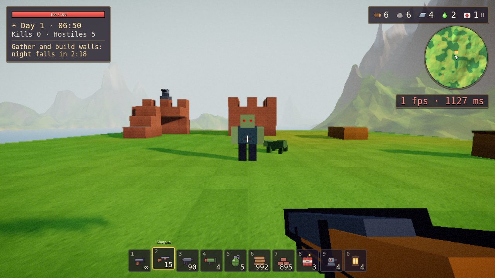
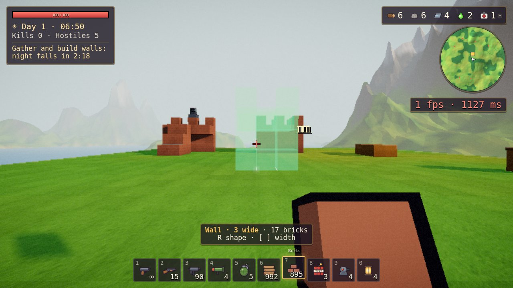
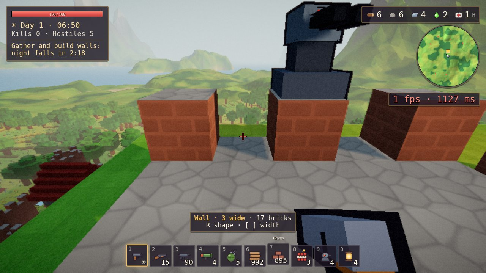
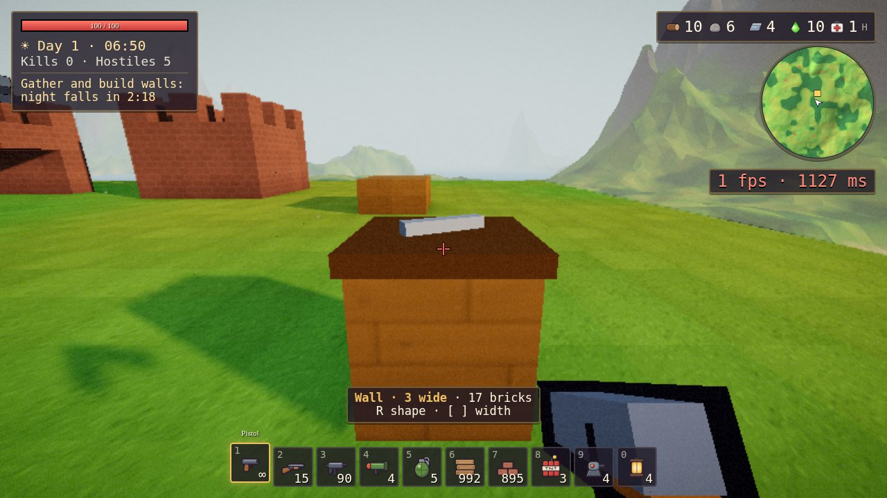
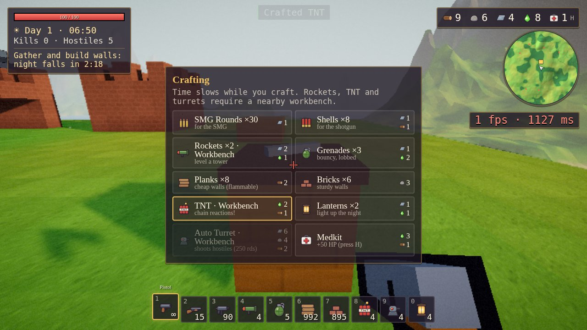
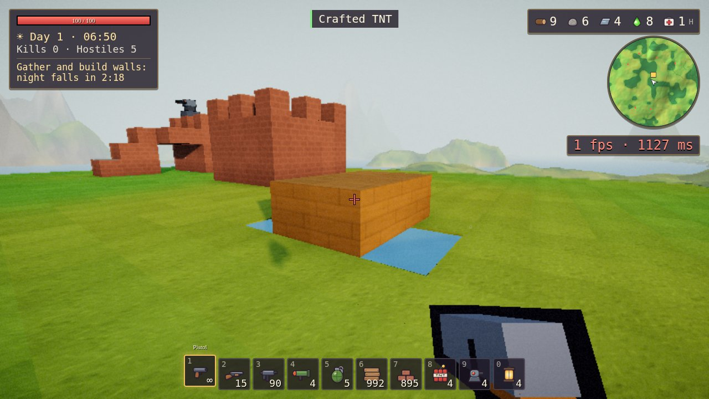
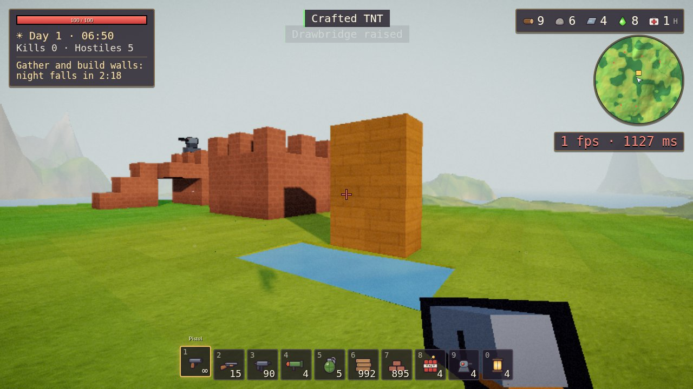

# First-person browser verification

These are direct Chromium screenshots from a running game. The test prepares a flat construction site, supplies building materials, places structures using the game's construction system, and positions the player for each view. These are controlled demonstration scenes; the images show the rendered result, while the assertions in `results.json` check specific game state. The images are not edited or annotated. The capture uses the game's low-quality rendering settings for software WebGL and fades the in-game controls hint. The displayed FPS reflects software WebGL in the capture environment, not a hardware performance benchmark.

These screenshots were captured by the former `tests/browser_proof.py` script. Its checks now run as a fast journey without screenshots: start `npx vite --port 5173 --strictPort`, then `npm run e2e -- browser-proof`. The script generates the images and [results.json](screenshots/first-person/results.json); it uses a temporary browser profile.

## Combat

A first-person shotgun view with spawned 3D enemies. The test fires with a browser mouse event and verifies ammunition, nine spawned pellets, and damage to the aimed enemy.

## Building

The prepared site contains battlements, stairs, a bastion and a wall-mounted turret, with a wall placement preview in the foreground. The script verifies placement costs and successful construction in game state.

## Workbench

The placed workbench and its crafting panel. The browser presses E and crafts a workbench recipe through the panel; the test checks the resulting inventory.

## Drawbridge

The same bridge lowered and raised over a prepared water-filled moat. The suite checks the bridge's raised state and six upright cells, and tests save/load restoration of view orientation and construction metadata. Additional state checks cover line-of-sight blocking, destruction and replacement of station and bridge blocks, support loss, navigation reset on load, quick-load pause, and rejected pointer capture.

